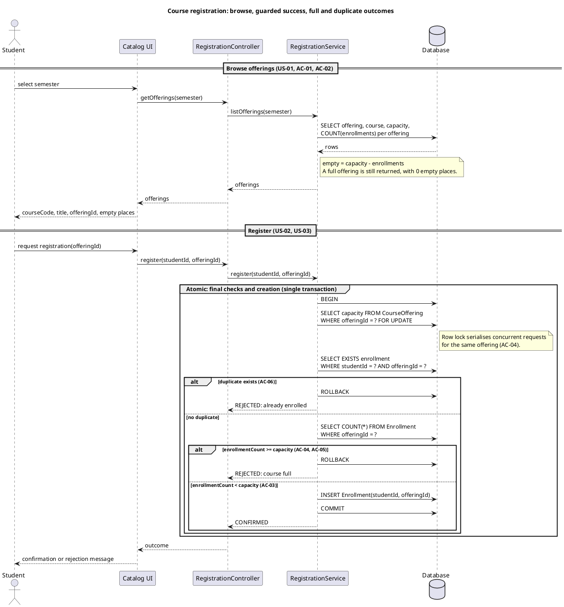
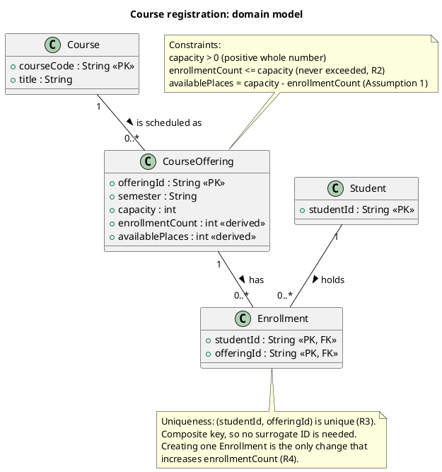

# SIS #02 — AI-Assisted UML Modeling: University Course Registration

<!--
  This is the only file you write your report in. README.md tells you what goes where.

  Rules the checker relies on:
  - Do not delete, rename or renumber the ## headings, the ### headings, or the **Label:** words.
  - Replace every "(write here)" and "(paste here)". None may be left when you submit.
  - Comments like this one are ignored by the checker and the word counter. Delete them or leave them.
-->

## 1. Scope and assumptions

<!-- Your FINAL scope statement and assumptions, after reviewing Prompt A's output. Say here
     what is out of scope (payments, prerequisites, timetable clashes, waiting lists,
     cancellation) — section 2 must not mention them. Section 10 keeps your first version. -->

**Scope:** System allows studnets to view the catalog of courses for one semester, chose some and register on it , if there is a empty place or he hasn't enrolled yet . Payments , prerequisites,timetable clashses, cancellation and waiting lists are not in scope.

**Assumptions:**

1. To calculate empty places on some course we use this formula : empty = capacity - enrollments
2. Each course and student has it's own id to be idenified. 

## 2. User stories and acceptance criteria

<!-- Your APPROVED requirements: Prompt A's draft after your review. Keep the IDs, the three
     story headings and the bullet shape. Every criterion names the rule(s) it maps to,
     e.g. (R2, R4). Two criteria per story. Nothing out of scope.
     Format of a criterion, on one bullet:
     - **AC-03** (R2, R4): Given ..., When ..., Then ... -->

### US-01 — Browse offerings

**US-01:** As a signed-in student, I want to see the course code, title, offering and available places for each offering in one semester, so that I can choose a section with open places.

- **AC-01** (R1): Given a signed-in student has selected a semester,
                  When the catalog is shown,
                  Then each offering for that semester displays its course code, title, offering ID and empty places calculated as capacity minus enrollments.
- **AC-02** (R-): Given an offering whose places are all taken, When the student opens the catalog for that semester, Then the offering is still listed and shows 0 available places.

### US-02 — Register for an offering

**US-02:** As a signed-in student, I want to register for an offering that has open places, so that I receive a confirmed place in that section.

- **AC-03** (R2,R3,R4): Given an offering with capacity 30 and 29 enrollments, and the student has no enrollment in that offering,
When the student requests registration,
Then the system rechecks availability, creates exactly one Enrollment linking the student ID and the offering ID, the enrollment count becomes 30, empty places become 0, and a confirmation is returned.
- **AC-04** (R2,R5): Given an offering whose catalog view showed 1 empty place, and another student registered after that view was loaded so that empty places are now 0,
When the student submits the registration request,
Then the system rechecks current availability, rejects the request with a “course full” explanation, and creates no Enrollment.

### US-03 — Receive a clear rejection

**US-03:** As a signed-in student, I want to be told clearly why a registration failed when the offering is full or I am already enrolled, so that I understand the outcome and know that nothing changed.

- **AC-05** (R2,R5): Given an offering with capacity 30 and 30 enrollments, and the student has no enrollment in that offering,
When the student requests registration,
Then the system rejects the request with a “course full” explanation, creates no Enrollment, and the enrollment count remains 30.
- **AC-06** (R3,R5): Given a student already holds an Enrollment in an offering that has open places,
When the student requests registration for that same offering again,
Then the system rejects the request with an “already enrolled” explanation, creates no new Enrollment, and the enrollment count is unchanged.

## 3. Sequence diagram

<!-- The FINAL diagram, rendered. Change .png to .svg if that is what you exported. -->


**Participants:** (write here — each lifeline and what it stands for)

**Atomic operation:** (write here — which messages form the one atomic step: the final duplicate check, the capacity check and the creation of the Enrollment, and why a catalog view reserves nothing)

**Where the Enrollment is created:** (write here — which message, which lifeline, and which class in section 4 it produces)

**Technical lifelines:** (write here — every lifeline that is NOT a class in the class diagram, by name, and why the difference in abstraction is fine. "None" if there are none.)

## 4. Class diagram

<!-- The FINAL diagram, rendered. -->


<!-- One row per association in classes.puml, read in both directions. -->

| Association | Read left to right | Read right to left |
| --- | --- | --- |
| (write here) | (write here) | (write here) |
| (write here) | (write here) | (write here) |
| (write here) | (write here) | (write here) |

**How an Enrollment links a student to an offering:** (write here)

**Capacity constraint:** (write here — and why multiplicity alone cannot express it)

**Uniqueness constraint:** (write here — and why multiplicity alone cannot express it)

## 5. Traceability

<!-- Every rule, including the catalog fields and availability (R1). Column 1: the rule and
     the criteria that cover it, e.g. "R2 + AC-03, AC-04". Column 2: the message, guard,
     class or constraint that shows the rule in YOUR diagrams. Column 3: the T-ID that
     exercises it, or the extra check you did instead (R1 has no T case). -->

| Rule and criterion | Model evidence | Validation case |
| --- | --- | --- |
| R1 + (write here) | (write here) | (write here) |
| R2 + (write here) | (write here) | (write here) |
| R3 + (write here) | (write here) | (write here) |
| R4 + (write here) | (write here) | (write here) |
| R5 + (write here) | (write here) | (write here) |

## 6. Walkthroughs

<!-- Walk each case through YOUR final sequence diagram, message by message. Column 2: the
     actual steps and the state change (count before → after). Column 3 starts with Pass or
     Fail, then the location: the message, guard or note where you saw it. A Fail you
     report honestly is a finding, not a penalty. -->

| Case | Observed path and state change | Judgment and evidence |
| --- | --- | --- |
| T1. Available | (write here) | (write here) |
| T2. Last place | (write here) | (write here) |
| T3. Full | (write here) | (write here) |
| T4. Duplicate | (write here) | (write here) |

## 7. Review decisions

<!-- At least three substantive decisions about Prompt C's critique or your own inspection.
     Decision: accepted / rejected / modified — and what you did. Reason: why, in a full
     sentence. Rule: R1–R5. Do not invent an error to fill the table; a justified rejection
     of advice counts. -->

| AI suggestion or model element | Decision | Reason | Rule |
| --- | --- | --- | --- |
| (write here) | (write here) | (write here) | (write here) |
| (write here) | (write here) | (write here) | (write here) |
| (write here) | (write here) | (write here) | (write here) |

## 8. Modeling explanation

<!-- 200–300 words. Your main design choices; how the class diagram and the sequence diagram
     complement each other; why an activity diagram could also help explain the workflow. -->

(write here)

## 9. Reflection

<!-- 150–200 words. Written by you, not by the assistant: where AI helped, one decision you
     made yourself, one remaining limitation. Specific beats flattering. -->

(write here)

## 10. Appendix A — Before AI

<!-- Written BEFORE you run Prompt A, committed and pushed in your first commit, and never
     edited afterwards. This is what you paste into Prompt A as "My initial assumptions". -->

**Scope:** System allows studnets to view the catalog of courses for one semester, chose some and register on it , if there is a empty place or he hasn't enrolled yet . Payments , prerequisites,timetable clashses, cancellation and waiting lists are not in scope.

**Initial assumptions:**

1. To calculate empty places on some course we use this formula : empty = capacity - enrollments
2. Each course and student has it's own id to be idenified.

## 11. Appendix B — AI exchanges

<!-- Complete prompts and complete responses, as text — never screenshots. Paste each inside
     the ~~~~ block that follows its label: AI responses contain ``` PlantUML blocks, and
     ~~~~ keeps them from breaking this file. Prompts B and C: the prompt text first, then
     the material it refers to ("below", "these two") pasted under it, in the same block.
     You may add B5, B6 … after B4 if you ran more. -->

### B1 — Requirements (Prompt A)

- **Tool:** Claude
- **Model:** Haiku 5.5 low
- **Date:** 2026-10-17
- **Purpose:** draft 3 user stories and 6 acceptance criteria

<!-- Model: the exact model with its version, as the tool shows it (e.g. "GPT-5 Thinking",
     "Claude Sonnet 4.5"). If the tool does not show it, write: not displayed
     Date: YYYY-MM-DD -->

**Prompt:**

~~~~text
Act as a requirements analyst. Use only this course registration scenario and rules R1–R5: A student browses an electronic course catalog, chooses a course offering and requests registration. Each offering has a limited number of places. A Course describes a subject. A CourseOffering is one scheduled section in one semester. Registration always targets a specific offering. Assume that the student is signed in, the selected offering exists, and its capacity is a positive whole number. Exclude payments, prerequisites, timetable clashes, waiting lists and cancellation. Use fictional students and courses.
R1. Catalog: Show the course code, title, offering and available places for one semester.
R2. Capacity: Recheck current availability when registering. Enrollment must never exceed the offering’s capacity.
R3. Duplicates: A student may have at most one enrollment in the same offering. Reject a repeat request.
R4. Success: Create exactly one Enrollment linking the student and offering, update availability and return a confirmation.
R5. Rejection: Explain “course full” or “already enrolled”. Create no enrollment and leave the enrollment count unchanged. My initial assumptions are 1. To calculate empty places on some course we use this formula : empty = capacity - enrollments
2. Each course and student has it's own id to be idenified. Draft 3 user stories and 2 Given / When / Then acceptance criteria for each. Use IDs US-01 to US-03 and AC-01 to AC-06. Map each criterion to rule IDs. Cover normal and rejection behavior. List uncertainty separately. Do not add excluded features or invent university policies.
~~~~

**Response:**

~~~~text
**Scope and assumptions**

The scenario covers browsing a course catalog, choosing one CourseOffering (one scheduled section of a Course in one semester), and requesting registration. Payments, prerequisites, timetable clashes, waiting lists and cancellation are out of scope. A signed-in student, an existing offering and a positive whole-number capacity are given.

Your assumptions are used as stated:
1. Empty places are calculated as `empty = capacity - enrollments`.
2. Each Course, CourseOffering and Student has its own ID.

**User stories**

**US-01 (Catalog browsing).** As a signed-in student, I want to see the course code, title, offering and available places for each offering in one semester, so that I can choose a section with open places.
- Rules: R1

**US-02 (Successful registration).** As a signed-in student, I want to register for an offering that has open places, so that I receive a confirmed place in that section.
- Rules: R2, R4

**US-03 (Rejected registration).** As a signed-in student, I want to be told clearly why a registration failed when the offering is full or I am already enrolled, so that I understand the outcome and know that nothing changed.
- Rules: R2, R3, R5

**Acceptance criteria**

**AC-01 (Catalog display; US-01).**
Given a signed-in student has selected a semester,
When the catalog is shown,
Then each offering for that semester displays its course code, title, offering ID and empty places calculated as capacity minus enrollments.
- Rules: R1, Assumption 1, Assumption 2

**AC-02 (Successful registration; US-02).**
Given an offering with capacity 30 and 29 enrollments, and the student has no enrollment in that offering,
When the student requests registration,
Then the system rechecks availability, creates exactly one Enrollment linking the student ID and the offering ID, the enrollment count becomes 30, empty places become 0, and a confirmation is returned.
- Rules: R2, R3, R4, Assumption 1, Assumption 2

**AC-03 (Rejection: course full; US-03).**
Given an offering with capacity 30 and 30 enrollments, and the student has no enrollment in that offering,
When the student requests registration,
Then the system rejects the request with a "course full" explanation, creates no Enrollment, and the enrollment count remains 30.
- Rules: R2, R5, Assumption 1

**AC-04 (Rejection: already enrolled; US-03).**
Given a student already holds an Enrollment in an offering that has open places,
When the student requests registration for that same offering again,
Then the system rejects the request with an "already enrolled" explanation, creates no new Enrollment, and the enrollment count is unchanged.
- Rules: R3, R5

**AC-05 (Availability recheck; US-02).**
Given an offering whose catalog view showed 1 empty place, and another student registered after that view was loaded so that empty places are now 0,
When the student submits the registration request,
Then the system rechecks current availability, rejects the request with a "course full" explanation, and creates no Enrollment.
- Rules: R2, R5

**AC-06 (Single enrollment on success; US-02).**
Given an offering with open places and a student with no enrollment in it,
When the student's registration request succeeds,
Then exactly one Enrollment exists linking that student ID and that offering ID, and a confirmation is returned.
- Rules: R4, R3

**Rule coverage**

| Rule | Covered by |
|---|---|
| R1 | US-01, AC-01 |
| R2 | US-02, US-03, AC-02, AC-03, AC-05 |
| R3 | US-02, US-03, AC-02, AC-04, AC-06 |
| R4 | US-02, AC-02, AC-06 |
| R5 | US-03, AC-03, AC-04, AC-05 |

Normal behavior is covered by AC-01, AC-02 and AC-06. Rejection behavior is covered by AC-03, AC-04 and AC-05.

**Uncertainties (listed separately)**

1. **Concurrency:** R2 requires a recheck, but the rules do not say how two simultaneous requests for the last place should be resolved. The requirement only states that enrollment must never exceed capacity.
2. **Message wording:** The rules name "course full" and "already enrolled" as explanations but do not define the exact text or whether both reasons can apply to one request.
3. **Confirmation content:** R4 requires a confirmation but does not specify its contents (for example, whether it includes course code, title or semester).
4. **Catalog refresh:** It is not stated how often the displayed empty-place count must update before a registration request.
5. **Duplicate check when full:** If a student is already enrolled in a full offering, the rules do not say which reason takes priority. AC-04 assumes the scenario is one where open places exist; this needs confirmation.
6. **Capacity changes:** The rules do not say what happens if an offering's capacity is reduced below its current enrollment count.
7. **Student and offering identity:** Assumption 2 gives each entity an ID, but the rules do not say whether IDs are system-generated or user-visible.
~~~~

### B2 — UML drafts (Prompt B)

- **Tool:** (write here)
- **Model:** (write here)
- **Date:** (write here)
- **Purpose:** draft the sequence and class diagrams

**Prompt:**

~~~~text
Using my approved scenario, R1–R5, stories and criteria below, return separate PlantUML code blocks for a sequence diagram and a domain class diagram.
Sequence: include catalog browsing and guarded success, full-course and duplicate outcomes. Model final checks and creation as one atomic operation.
Class: show domain concepts, useful attributes and multiplicities. State the capacity and uniqueness constraints. Explain assumptions and any technical lifelines.
### US-01 — Browse offerings

**US-01:** As a signed-in student, I want to see the course code, title, offering and available places for each offering in one semester, so that I can choose a section with open places.

- **AC-01** (R1): Given a signed-in student has selected a semester,
                  When the catalog is shown,
                  Then each offering for that semester displays its course code, title, offering ID and empty places calculated as capacity minus enrollments.
- **AC-02** (R-): Given an offering whose places are all taken, When the student opens the catalog for that semester, Then the offering is still listed and shows 0 available places.

### US-02 — Register for an offering

**US-02:** As a signed-in student, I want to register for an offering that has open places, so that I receive a confirmed place in that section.

- **AC-03** (R2,R3,R4): Given an offering with capacity 30 and 29 enrollments, and the student has no enrollment in that offering,
When the student requests registration,
Then the system rechecks availability, creates exactly one Enrollment linking the student ID and the offering ID, the enrollment count becomes 30, empty places become 0, and a confirmation is returned.
- **AC-04** (R2,R5): Given an offering whose catalog view showed 1 empty place, and another student registered after that view was loaded so that empty places are now 0,
When the student submits the registration request,
Then the system rechecks current availability, rejects the request with a “course full” explanation, and creates no Enrollment.

### US-03 — Receive a clear rejection

**US-03:** As a signed-in student, I want to be told clearly why a registration failed when the offering is full or I am already enrolled, so that I understand the outcome and know that nothing changed.

- **AC-05** (R2,R5): Given an offering with capacity 30 and 30 enrollments, and the student has no enrollment in that offering,
When the student requests registration,
Then the system rejects the request with a “course full” explanation, creates no Enrollment, and the enrollment count remains 30.
- **AC-06** (R3,R5): Given a student already holds an Enrollment in an offering that has open places,
When the student requests registration for that same offering again,
Then the system rejects the request with an “already enrolled” explanation, creates no new Enrollment, and the enrollment count is unchanged.
~~~~

**Response:**

~~~~text
**Sequence diagram**



**Class diagram**



**Assumptions**

- The catalog lists the Course title and code from Course. CourseOffering holds the semester and capacity, and the offering ID is shown in the catalog.
- `enrollmentCount` and `availablePlaces` are derived from Enrollment rows and are not stored independently, so they cannot drift from the enrollment count.
- Semester is an attribute of CourseOffering rather than its own class, because the scenario does not describe semester behaviour.
- The composite key on Enrollment enforces R3 at the data level, so no surrogate ID is needed.
- The sequence diagram checks duplicate status before capacity. This order is my assumption, since the rules do not set a priority when both conditions hold. See the uncertainty below.

**Technical lifelines**

- **Catalog UI and RegistrationController** are presentation and request-handling layers. They pass requests through and display outcomes but make no decisions about capacity.
- **RegistrationService** owns the business rules and is the only place where the final checks and creation happen.
- **Database** provides the atomic transaction and the row lock (`FOR UPDATE`) that stop two requests from taking the last place at the same time.

**Recommended safeguard (not shown in the diagram)**

The database should also enforce a unique constraint on (studentId, offeringId) and a check that enrollments do not exceed capacity. These act as a backstop if application code is bypassed.

**Gaps and uncertainties**

1. **AC-02 rule ID "R-" is not defined.** It cannot be traced to R1–R5. I have treated it as a catalog display case under R1. Please confirm or give it a correct rule ID.
2. **Priority of duplicate and full checks.** If a student is already enrolled in a full offering, the diagram returns "already enrolled". This needs your confirmation.
3. **Lock scope.** The diagram assumes locking the offering row is enough to guard capacity. This depends on the database and should be confirmed during design.
~~~~

### B3 — Model critique (Prompt C)

- **Tool:** (write here)
- **Model:** (write here)
- **Date:** (write here)
- **Purpose:** review both models against R1–R5 and T1–T4

**Prompt:**

~~~~text
(paste here)
~~~~

**Response:**

~~~~text
(paste here)
~~~~

### B4 — Focused revision (Prompt D)

- **Tool:** (write here)
- **Model:** (write here)
- **Date:** (write here)
- **Purpose:** apply my accepted review decisions

**Prompt:**

~~~~text
(paste here)
~~~~

**Response:**

~~~~text
(paste here)
~~~~

## 12. Appendix C — Original diagrams

<!-- The AI's first output from Prompt B, rendered unedited from models/original/. -->


## 13. Appendix D — References and source checks

### References

<!-- Full references, one per line, each starting with "- ". Only sources you actually opened.
     Every URL used in the source checks must also appear here. Example:
     - Sommerville, I. (2016). Software Engineering, 10th ed., Global Edition. Pearson. Ch. 5. -->

- (write here)

### Source checks

<!-- At least two modeling decisions you verified. Source and locator: title + slide, page,
     section, chapter or figure — or title + URL + access date (YYYY-MM-DD). Slide numbers
     refer to the decks posted in our Teams. -->

| Modeling decision | Source and locator | What the source says | How it supports or changed your model |
| --- | --- | --- | --- |
| (write here) | (write here) | (write here) | (write here) |
| (write here) | (write here) | (write here) | (write here) |
