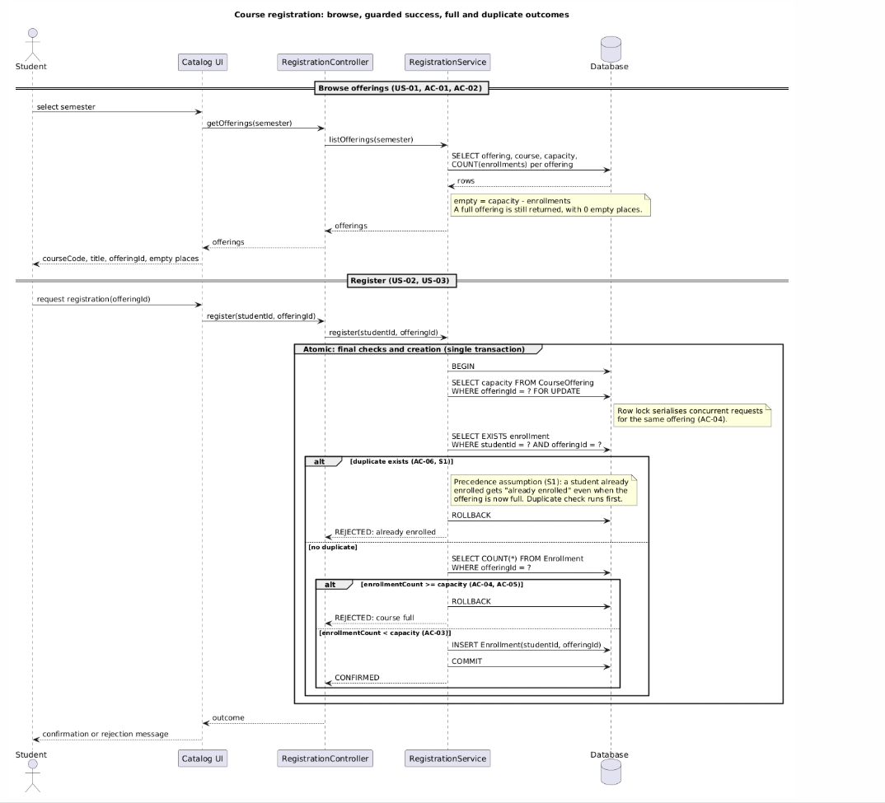
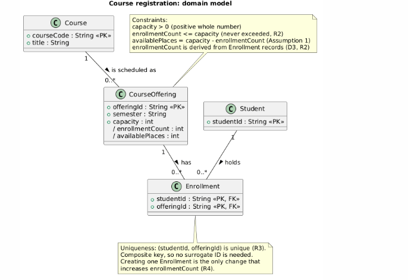
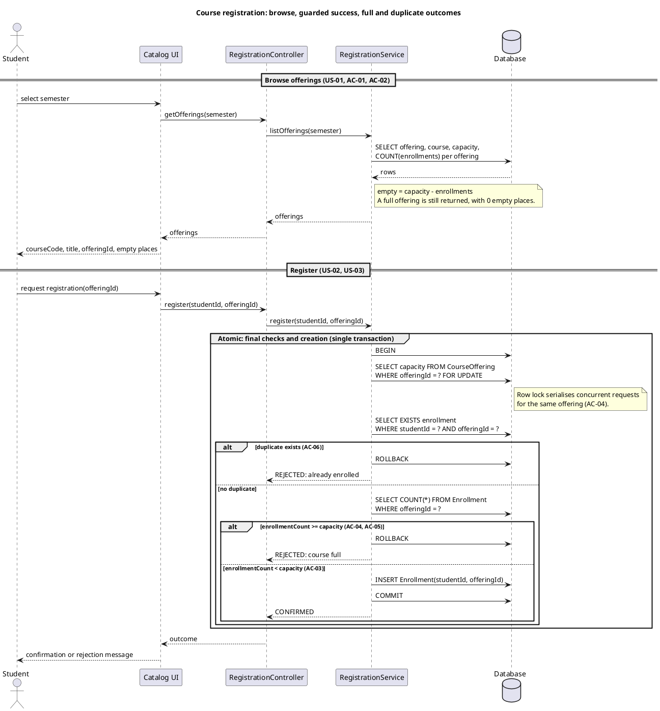
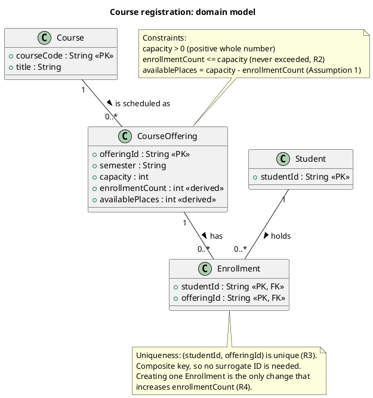
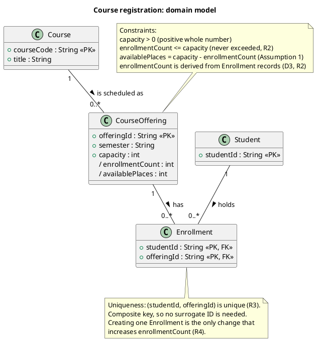
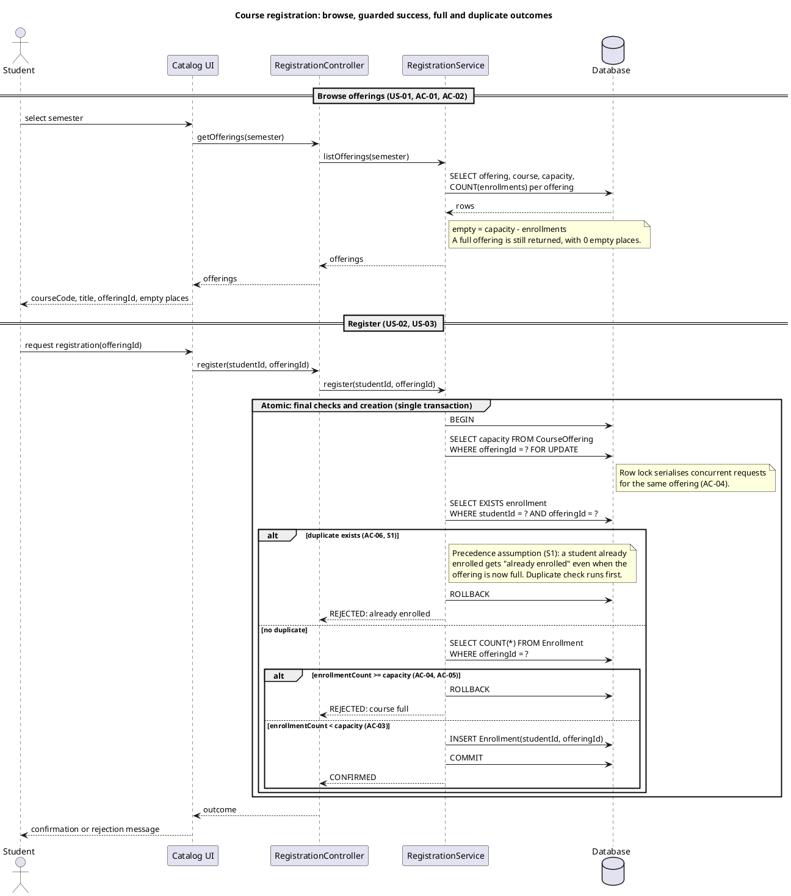
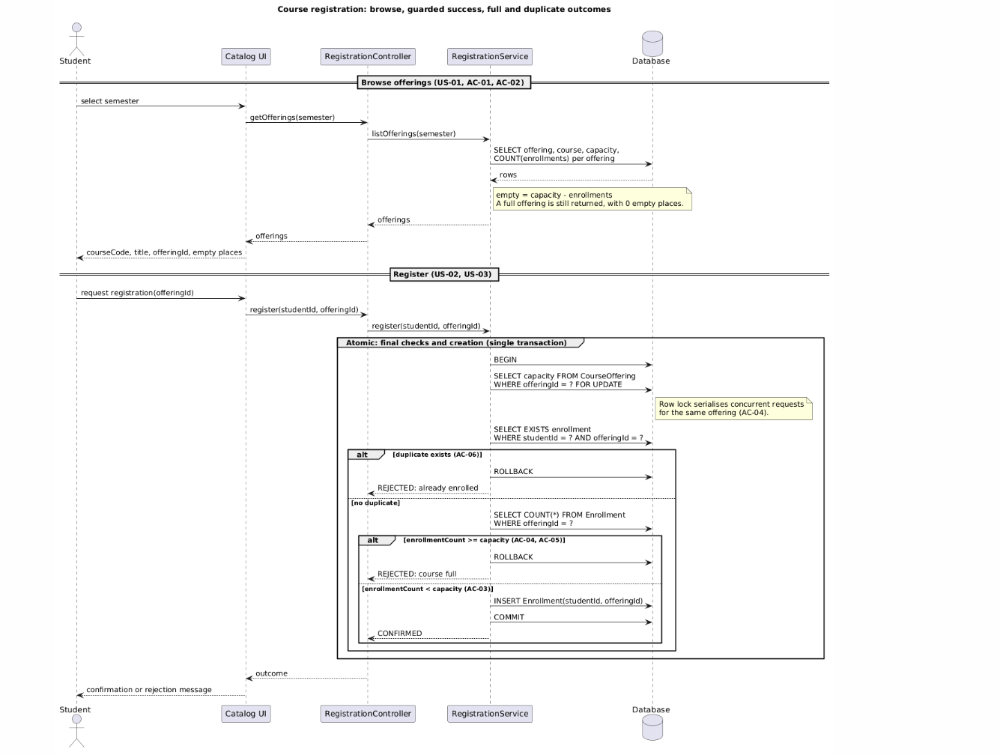
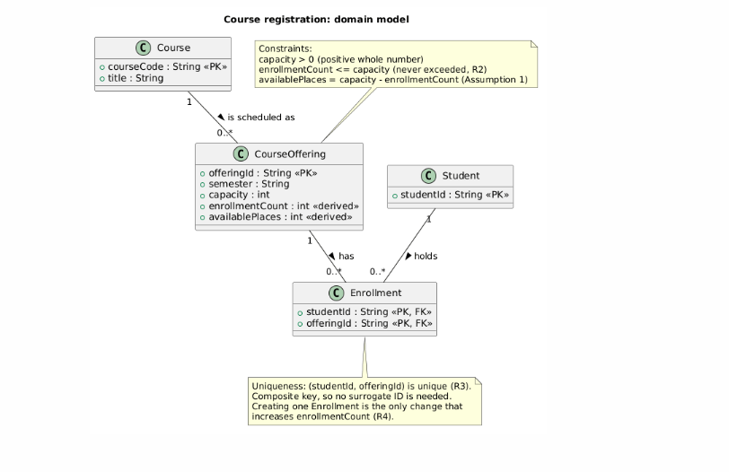

# SIS #02 — AI-Assisted UML Modeling: University Course Registration

<!--
  This is the only file you write your report in. README.md tells you what goes where.

  Rules the checker relies on:
  - Do not delete, rename or renumber the ## headings, the ### headings, or the **Label:** words.
  - Replace every "(write here)" and "(paste here)". None may be left when you submit.
  - Comments like this one are ignored by the checker and the word counter. Delete them or leave them.
-->

## 1. Scope and assumptions

<!-- Your FINAL scope statement and assumptions, after reviewing Prompt A's output. Say here
     what is out of scope (payments, prerequisites, timetable clashes, waiting lists,
     cancellation) — section 2 must not mention them. Section 10 keeps your first version. -->

**Scope:** System allows studnets to view the catalog of courses for one semester, chose some and register on it , if there is a empty place or he hasn't enrolled yet . Payments , prerequisites,timetable clashses, cancellation and waiting lists are not in scope.

**Assumptions:**

1. To calculate empty places on some course we use this formula : empty = capacity - enrollments
2. Each course and student has it's own id to be idenified. 

## 2. User stories and acceptance criteria

<!-- Your APPROVED requirements: Prompt A's draft after your review. Keep the IDs, the three
     story headings and the bullet shape. Every criterion names the rule(s) it maps to,
     e.g. (R2, R4). Two criteria per story. Nothing out of scope.
     Format of a criterion, on one bullet:
     - **AC-03** (R2, R4): Given ..., When ..., Then ... -->

### US-01 — Browse offerings

**US-01:** As a signed-in student, I want to see the course code, title, offering and available places for each offering in one semester, so that I can choose a section with open places.

- **AC-01** (R1): Given a signed-in student has selected a semester,
                  When the catalog is shown,
                  Then each offering for that semester displays its course code, title, offering ID and empty places calculated as capacity minus enrollments.
- **AC-02** (R1): Given an offering whose places are all taken, When the student opens the catalog for that semester, Then the offering is still listed and shows 0 available places.

### US-02 — Register for an offering

**US-02:** As a signed-in student, I want to register for an offering that has open places, so that I receive a confirmed place in that section.

- **AC-03** (R2,R3,R4): Given an offering with capacity 30 and 29 enrollments, and the student has no enrollment in that offering,
When the student requests registration,
Then the system rechecks availability, creates exactly one Enrollment linking the student ID and the offering ID, the enrollment count becomes 30, empty places become 0, and a confirmation is returned.
- **AC-04** (R2,R5): Given an offering whose catalog view showed 1 empty place, and another student registered after that view was loaded so that empty places are now 0,
When the student submits the registration request,
Then the system rechecks current availability, rejects the request with a “course full” explanation, and creates no Enrollment.

### US-03 — Receive a clear rejection

**US-03:** As a signed-in student, I want to be told clearly why a registration failed when the offering is full or I am already enrolled, so that I understand the outcome and know that nothing changed.

- **AC-05** (R2,R5): Given an offering with capacity 30 and 30 enrollments, and the student has no enrollment in that offering,
When the student requests registration,
Then the system rejects the request with a “course full” explanation, creates no Enrollment, and the enrollment count remains 30.
- **AC-06** (R3,R5): Given a student already holds an Enrollment in an offering that has open places,
When the student requests registration for that same offering again,
Then the system rejects the request with an “already enrolled” explanation, creates no new Enrollment, and the enrollment count is unchanged.

## 3. Sequence diagram

<!-- The FINAL diagram, rendered. Change .png to .svg if that is what you exported. -->



**Participants:** Student (actor) is the person who selects a semester, browses the offerings and requests registration. Catalog UI shows the offerings and passes the student's requests on. RegistrationController receives the calls from the UI and forwards them. RegistrationService holds the registration logic: it lists offerings with their empty places and runs the final duplicate and capacity checks. Database stores the offerings, their capacities and the enrollments.

**Atomic operation:** The messages inside the group "Atomic: final checks and creation (single transaction)" form one atomic step: BEGIN, the row lock on the offering (SELECT ... FOR UPDATE), the duplicate check (SELECT EXISTS), the capacity check (SELECT COUNT), and then either ROLLBACK (rejection) or INSERT Enrollment followed by COMMIT (success). Because the offering row is locked, two students competing for the last place cannot both pass the capacity check: the second request waits, then sees the updated count and is rejected as "course full". A catalog view reserves nothing: it only reads capacity and the enrollment count, so the empty places it shows may already be outdated, which is why both checks are repeated inside the atomic step.

**Where the Enrollment is created:** In the message `RegistrationService -> Database : INSERT Enrollment(studentId, offeringId)`, sent by the RegistrationService lifeline to the Database, in the success branch (guard `enrollmentCount < capacity`, after `no duplicate`). It produces one record of the class Enrollment from section 4, linking one Student to one CourseOffering. CONFIRMED is returned only after this INSERT and the COMMIT.

**Technical lifelines:** Catalog UI, RegistrationController, RegistrationService and Database are not classes in the class diagram. They are parts of the technical architecture, not domain concepts: the class diagram shows what the university knows (Student, Course, CourseOffering, Enrollment), while the sequence diagram also shows which component does the work and in which order. The difference in abstraction is fine because the Database lifeline stores the four domain classes, and the RegistrationService only reads and creates Enrollment records without introducing any new domain concept.

## 4. Class diagram

<!-- The FINAL diagram, rendered. -->



<!-- One row per association in classes.puml, read in both directions. -->

| Association | Read left to right | Read right to left |
| --- | --- | --- |
| Course “1” -- “0..*” CourseOffering : is scheduled as | One Course is scheduled as zero or more CourseOfferings. | Each CourseOffering belongs to exactly one Course. |
| CourseOffering “1” -- “0..*” Enrollment : has | One CourseOffering has zero or more Enrollments. | Each Enrollment belongs to exactly one CourseOffering. |
| Student “1” -- “0..*” Enrollment : holds | One Student holds zero or more Enrollments. | Each Enrollment is held by exactly one Student. |

**How an Enrollment links a student to an offering:** An Enrollment is the record that connects one Student to one CourseOffering. It has one association to Student (multiplicity "1" on the Student end) and one to CourseOffering (multiplicity "1" on the CourseOffering end), and it carries both identifiers (studentId and offeringId) as its composite key. So each Enrollment points to exactly one student and exactly one offering, while a student can hold many enrollments (0..*) and an offering can have many enrollments (0..*), up to its capacity.

**Capacity constraint:** The number of Enrollments of a CourseOffering must never exceed its capacity: enrollmentCount <= capacity (R2), where capacity is a positive whole number and availablePlaces = capacity - enrollmentCount. Multiplicity alone cannot express this, because the multiplicity "0..*" between CourseOffering and Enrollment is a fixed range that is the same for every offering, while the limit here is a value that differs per offering (one offering has capacity 30, another 2) and is stored in an attribute. So the rule is written as a constraint in a note on CourseOffering and enforced by the atomic check in the sequence diagram.

**Uniqueness constraint:** A student may have at most one Enrollment in the same offering: the pair (studentId, offeringId) is unique (R3). Multiplicity alone cannot express this, because "Student 1 -- 0..* Enrollment" and "CourseOffering 1 -- 0..* Enrollment" each describe one end of the association separately. Each end allows many enrollments, and they say nothing about the combination of the two ends being repeated. The rule is stated in a note on Enrollment and backed by the composite key, and the duplicate check in the sequence diagram enforces it when a student registers.

## 5. Traceability

<!-- Every rule, including the catalog fields and availability (R1). Column 1: the rule and
     the criteria that cover it, e.g. "R2 + AC-03, AC-04". Column 2: the message, guard,
     class or constraint that shows the rule in YOUR diagrams. Column 3: the T-ID that
     exercises it, or the extra check you did instead (R1 has no T case). -->

| Rule and criterion | Model evidence | Validation case |
| --- | --- | --- |
| R1 + AC-01, AC-02 | Sequence, section “Browse offerings”: getOfferings(semester) → listOfferings(semester) → the SELECT offering, course, capacity, COUNT(enrollments) query, and the final message returning courseCode, title, offeringId, empty places. The note “A full offering is still returned, with 0 empty places” covers AC-02. Class: Course.courseCode, Course.title, CourseOffering.semester, /availablePlaces. | No T case. Extra check: I traced the browse section for an offering with 0 empty places and confirmed it is still returned and shown with 0 places. |
| R2 + AC-03, AC-04, AC-05 | Sequence: the group “Atomic: final checks and creation”, the SELECT capacity ... FOR UPDATE row lock, the SELECT COUNT(*) capacity check and the guard enrollmentCount >= capacity → REJECTED: course full. Class: note on CourseOffering, enrollmentCount <= capacity. | T2 (last place), T3 (full)|
| R3 + AC-03, AC-06 | Sequence: SELECT EXISTS enrollment WHERE studentId = ? AND offeringId = ? and the guard duplicate exists → REJECTED: already enrolled. Class: note on Enrollment, (studentId, offeringId) is unique, with the composite key. | T4 (duplicate) |
| R4 + AC-03 | Sequence: success guard enrollmentCount < capacity → INSERT Enrollment(studentId, offeringId), then COMMIT, then CONFIRMED. Class: Enrollment linked to one Student and one CourseOffering; /availablePlaces is derived from the enrollments, so it updates on its own.| T1 (available), T2 (last place)|
| R5 + AC-04, AC-05, AC-06 | Sequence: both rejection branches contain only ROLLBACK and REJECTED: course full / REJECTED: already enrolled, with no INSERT, no COMMIT and no CONFIRMED. So no Enrollment is created and the count stays the same. | T3 (full), T4 (duplicate)|

## 6. Walkthroughs

<!-- Walk each case through YOUR final sequence diagram, message by message. Column 2: the
     actual steps and the state change (count before → after). Column 3 starts with Pass or
     Fail, then the location: the message, guard or note where you saw it. A Fail you
     report honestly is a finding, not a penalty. -->

| Case | Observed path and state change | Judgment and evidence |
| --- | --- | --- |
| T1. Available | Student sends request registration(offeringId). UI calls register(studentId, offeringId) on the Controller, which calls the Service. Inside the Atomic group: BEGIN, SELECT capacity ... FOR UPDATE (capacity 2), SELECT EXISTS enrollment finds nothing, so the branch duplicate exists is skipped and no duplicate is taken. SELECT COUNT(*) returns 0, the guard enrollmentCount >= capacity is false (0 < 2), so the branch enrollmentCount < capacity runs: INSERT Enrollment(studentId, offeringId), COMMIT, CONFIRMED. The UI shows the confirmation. Enrollment count: 0 → 1. | Pass. Seen in the innermost else enrollmentCount < capacity (AC-03) branch: one INSERT, then COMMIT, then CONFIRMED. |
| T2. Last place | Same path as T1, starting with capacity 2 and 1 enrollment by another student. SELECT EXISTS finds nothing for this student, SELECT COUNT(*) returns 1, and 1 < 2 so the guard enrollmentCount < capacity is true. INSERT Enrollment, COMMIT, CONFIRMED. Enrollment count: 1 → 2, so availablePlaces = 2 - 2 = 0. | Pass. Seen in the same else enrollmentCount < capacity (AC-03) branch. The count reaches capacity but never exceeds it, and the row lock stops a second student from taking the same place. |
| T3. Full | The catalog earlier showed 1 empty place (browse section), but meanwhile another student took it. Registration request goes down the same chain into the Atomic group: BEGIN, row lock, SELECT EXISTS finds nothing (branch no duplicate), SELECT COUNT(*) returns 2, and 2 >= 2 so the guard enrollmentCount >= capacity (AC-04, AC-05) is true. ROLLBACK, then REJECTED: course full. No INSERT, COMMIT or CONFIRMED. Enrollment count: 2 → 2.| Pass. Seen in the branch enrollmentCount >= capacity (AC-04, AC-05): it contains only ROLLBACK and REJECTED: course full. The stale catalog view is not used, because the count is read again under the lock. |
| T4. Duplicate | The same student who already holds the 1 enrollment sends the request again. In the Atomic group SELECT EXISTS enrollment WHERE studentId = ? AND offeringId = ? finds the existing record, so the branch duplicate exists (AC-06, S1) is taken: ROLLBACK, then REJECTED: already enrolled. The capacity check is never reached. No INSERT. Enrollment count: 1 → 1. | Pass. Seen in the alt duplicate exists (AC-06, S1) branch: only ROLLBACK and REJECTED: already enrolled. |

## 7. Review decisions

<!-- At least three substantive decisions about Prompt C's critique or your own inspection.
     Decision: accepted / rejected / modified — and what you did. Reason: why, in a full
     sentence. Rule: R1–R5. Do not invent an error to fill the table; a justified rejection
     of advice counts. -->

| AI suggestion or model element | Decision | Reason | Rule |
| --- | --- | --- | --- |
| D3: CourseOffering attributes enrollmentCount and availablePlaces marked <<derived>> with + visibility | accepted | The slash is the standard UML notation for derived attributes, and the + suggested a stored field that a service could write directly, which could let availability drift from the real Enrollment records. | R2 |
| S1: no criterion for a student already enrolled in an offering that is now full | modified | The assignment fixes exactly six criteria, so I recorded the precedence as an assumption, and “already enrolled” is the more accurate message for that student. | R3,R5) |
| D2: add a validateSession guard before browse and register | rejected | The scenario states the student is already signed in, so modeling authentication would add behavior outside the agreed scope. | R3 |

## 8. Modeling explanation

<!-- 200–300 words. Your main design choices; how the class diagram and the sequence diagram
     complement each other; why an activity diagram could also help explain the workflow. -->

I kept the domain model small: four classes, Student, Course, CourseOffering and Enrollment. Course describes the subject (code and title), while CourseOffering is one section in one semester and carries the capacity. I made Enrollment a separate class instead of a list inside Student or CourseOffering, because it is the record that links exactly one student to exactly one offering, and its composite key (studentId, offeringId) expresses the uniqueness rule R3. Available places are derived (capacity minus enrollmentCount) instead of stored, so the number cannot drift away from the real Enrollment records. Capacity and uniqueness are written as separate notes, because multiplicity cannot express either of them.

In the sequence diagram I treat the catalog view as read-only information. It reserves nothing, so the registration request repeats the checks. The duplicate check, the capacity check and the creation of the Enrollment sit in one atomic group with a row lock, so two students cannot take the last place. The duplicate is tested first, which gives an already enrolled student the message "already enrolled" even if the offering is full. Rejection branches only roll back and return a reason.

The two diagrams complement each other. The class diagram shows what exists and which constraints always hold; the sequence diagram shows when those constraints are checked, in which order, and who performs each step. Neither is enough alone: the class diagram cannot show the stale catalog problem, and the sequence diagram cannot show the structure of the data.

An activity diagram could also help, because it shows the workflow as decisions and branches: start, check duplicate, check capacity, create or reject, end. It lets a non-technical reader follow the three outcomes without lifelines.

## 9. Reflection

<!-- 150–200 words. Written by you, not by the assistant: where AI helped, one decision you
     made yourself, one remaining limitation. Specific beats flattering. -->

During this assignment, I worked with AI to construct UML diagrams for a Student Course Registration System. Firstly, I created the US-01 user story and its acceptance criteria. However, the AI initially provided only one acceptance criterion, so I decided to add another one myself. I chose a scenario in which a student views the course catalog and sees that courses with no available places are marked as full. I considered this situation important because it helps students understand course availability before attempting to register.

During the process, the AI suggested many corrections to my UML diagrams. I agreed with almost all of them because the suggestions were reasonable and helped improve the quality and accuracy of the diagrams. The AI also checked the diagrams carefully and identified several issues that I might have overlooked.

Overall, this assignment showed me that AI can be a useful tool for reviewing and improving technical documentation. However, I also learned that I should actively participate in the process, make my own decisions, and evaluate AI suggestions instead of accepting everything automatically.

## 10. Appendix A — Before AI

<!-- Written BEFORE you run Prompt A, committed and pushed in your first commit, and never
     edited afterwards. This is what you paste into Prompt A as "My initial assumptions". -->

**Scope:** System allows studnets to view the catalog of courses for one semester, chose some and register on it , if there is a empty place or he hasn't enrolled yet . Payments , prerequisites,timetable clashses, cancellation and waiting lists are not in scope.

**Initial assumptions:**

1. To calculate empty places on some course we use this formula : empty = capacity - enrollments
2. Each course and student has it's own id to be idenified.

## 11. Appendix B — AI exchanges

<!-- Complete prompts and complete responses, as text — never screenshots. Paste each inside
     the ~~~~ block that follows its label: AI responses contain ``` PlantUML blocks, and
     ~~~~ keeps them from breaking this file. Prompts B and C: the prompt text first, then
     the material it refers to ("below", "these two") pasted under it, in the same block.
     You may add B5, B6 … after B4 if you ran more. -->

### B1 — Requirements (Prompt A)

- **Tool:** Claude
- **Model:** Haiku 5.5 low
- **Date:** 2026-10-17
- **Purpose:** draft 3 user stories and 6 acceptance criteria

<!-- Model: the exact model with its version, as the tool shows it (e.g. "GPT-5 Thinking",
     "Claude Sonnet 4.5"). If the tool does not show it, write: not displayed
     Date: YYYY-MM-DD -->

**Prompt:**

~~~~text
Act as a requirements analyst. Use only this course registration scenario and rules R1–R5: A student browses an electronic course catalog, chooses a course offering and requests registration. Each offering has a limited number of places. A Course describes a subject. A CourseOffering is one scheduled section in one semester. Registration always targets a specific offering. Assume that the student is signed in, the selected offering exists, and its capacity is a positive whole number. Exclude payments, prerequisites, timetable clashes, waiting lists and cancellation. Use fictional students and courses.
R1. Catalog: Show the course code, title, offering and available places for one semester.
R2. Capacity: Recheck current availability when registering. Enrollment must never exceed the offering’s capacity.
R3. Duplicates: A student may have at most one enrollment in the same offering. Reject a repeat request.
R4. Success: Create exactly one Enrollment linking the student and offering, update availability and return a confirmation.
R5. Rejection: Explain “course full” or “already enrolled”. Create no enrollment and leave the enrollment count unchanged. My initial assumptions are 1. To calculate empty places on some course we use this formula : empty = capacity - enrollments
2. Each course and student has it's own id to be idenified. Draft 3 user stories and 2 Given / When / Then acceptance criteria for each. Use IDs US-01 to US-03 and AC-01 to AC-06. Map each criterion to rule IDs. Cover normal and rejection behavior. List uncertainty separately. Do not add excluded features or invent university policies.
~~~~

**Response:**

~~~~text
**Scope and assumptions**

The scenario covers browsing a course catalog, choosing one CourseOffering (one scheduled section of a Course in one semester), and requesting registration. Payments, prerequisites, timetable clashes, waiting lists and cancellation are out of scope. A signed-in student, an existing offering and a positive whole-number capacity are given.

Your assumptions are used as stated:
1. Empty places are calculated as `empty = capacity - enrollments`.
2. Each Course, CourseOffering and Student has its own ID.

**User stories**

**US-01 (Catalog browsing).** As a signed-in student, I want to see the course code, title, offering and available places for each offering in one semester, so that I can choose a section with open places.
- Rules: R1

**US-02 (Successful registration).** As a signed-in student, I want to register for an offering that has open places, so that I receive a confirmed place in that section.
- Rules: R2, R4

**US-03 (Rejected registration).** As a signed-in student, I want to be told clearly why a registration failed when the offering is full or I am already enrolled, so that I understand the outcome and know that nothing changed.
- Rules: R2, R3, R5

**Acceptance criteria**

**AC-01 (Catalog display; US-01).**
Given a signed-in student has selected a semester,
When the catalog is shown,
Then each offering for that semester displays its course code, title, offering ID and empty places calculated as capacity minus enrollments.
- Rules: R1, Assumption 1, Assumption 2

**AC-02 (Successful registration; US-02).**
Given an offering with capacity 30 and 29 enrollments, and the student has no enrollment in that offering,
When the student requests registration,
Then the system rechecks availability, creates exactly one Enrollment linking the student ID and the offering ID, the enrollment count becomes 30, empty places become 0, and a confirmation is returned.
- Rules: R2, R3, R4, Assumption 1, Assumption 2

**AC-03 (Rejection: course full; US-03).**
Given an offering with capacity 30 and 30 enrollments, and the student has no enrollment in that offering,
When the student requests registration,
Then the system rejects the request with a "course full" explanation, creates no Enrollment, and the enrollment count remains 30.
- Rules: R2, R5, Assumption 1

**AC-04 (Rejection: already enrolled; US-03).**
Given a student already holds an Enrollment in an offering that has open places,
When the student requests registration for that same offering again,
Then the system rejects the request with an "already enrolled" explanation, creates no new Enrollment, and the enrollment count is unchanged.
- Rules: R3, R5

**AC-05 (Availability recheck; US-02).**
Given an offering whose catalog view showed 1 empty place, and another student registered after that view was loaded so that empty places are now 0,
When the student submits the registration request,
Then the system rechecks current availability, rejects the request with a "course full" explanation, and creates no Enrollment.
- Rules: R2, R5

**AC-06 (Single enrollment on success; US-02).**
Given an offering with open places and a student with no enrollment in it,
When the student's registration request succeeds,
Then exactly one Enrollment exists linking that student ID and that offering ID, and a confirmation is returned.
- Rules: R4, R3

**Rule coverage**

| Rule | Covered by |
|---|---|
| R1 | US-01, AC-01 |
| R2 | US-02, US-03, AC-02, AC-03, AC-05 |
| R3 | US-02, US-03, AC-02, AC-04, AC-06 |
| R4 | US-02, AC-02, AC-06 |
| R5 | US-03, AC-03, AC-04, AC-05 |

Normal behavior is covered by AC-01, AC-02 and AC-06. Rejection behavior is covered by AC-03, AC-04 and AC-05.

**Uncertainties (listed separately)**

1. **Concurrency:** R2 requires a recheck, but the rules do not say how two simultaneous requests for the last place should be resolved. The requirement only states that enrollment must never exceed capacity.
2. **Message wording:** The rules name "course full" and "already enrolled" as explanations but do not define the exact text or whether both reasons can apply to one request.
3. **Confirmation content:** R4 requires a confirmation but does not specify its contents (for example, whether it includes course code, title or semester).
4. **Catalog refresh:** It is not stated how often the displayed empty-place count must update before a registration request.
5. **Duplicate check when full:** If a student is already enrolled in a full offering, the rules do not say which reason takes priority. AC-04 assumes the scenario is one where open places exist; this needs confirmation.
6. **Capacity changes:** The rules do not say what happens if an offering's capacity is reduced below its current enrollment count.
7. **Student and offering identity:** Assumption 2 gives each entity an ID, but the rules do not say whether IDs are system-generated or user-visible.
~~~~

### B2 — UML drafts (Prompt B)

- **Tool:** Claude
- **Model:** Haiku 5.5 low
- **Date:** 2026-10-17
- **Purpose:** draft the sequence and class diagrams

**Prompt:**

~~~~text
Using my approved scenario, R1–R5, stories and criteria below, return separate PlantUML code blocks for a sequence diagram and a domain class diagram.
Sequence: include catalog browsing and guarded success, full-course and duplicate outcomes. Model final checks and creation as one atomic operation.
Class: show domain concepts, useful attributes and multiplicities. State the capacity and uniqueness constraints. Explain assumptions and any technical lifelines.
### US-01 — Browse offerings

**US-01:** As a signed-in student, I want to see the course code, title, offering and available places for each offering in one semester, so that I can choose a section with open places.

- **AC-01** (R1): Given a signed-in student has selected a semester,
                  When the catalog is shown,
                  Then each offering for that semester displays its course code, title, offering ID and empty places calculated as capacity minus enrollments.
- **AC-02** (R-): Given an offering whose places are all taken, When the student opens the catalog for that semester, Then the offering is still listed and shows 0 available places.

### US-02 — Register for an offering

**US-02:** As a signed-in student, I want to register for an offering that has open places, so that I receive a confirmed place in that section.

- **AC-03** (R2,R3,R4): Given an offering with capacity 30 and 29 enrollments, and the student has no enrollment in that offering,
When the student requests registration,
Then the system rechecks availability, creates exactly one Enrollment linking the student ID and the offering ID, the enrollment count becomes 30, empty places become 0, and a confirmation is returned.
- **AC-04** (R2,R5): Given an offering whose catalog view showed 1 empty place, and another student registered after that view was loaded so that empty places are now 0,
When the student submits the registration request,
Then the system rechecks current availability, rejects the request with a “course full” explanation, and creates no Enrollment.

### US-03 — Receive a clear rejection

**US-03:** As a signed-in student, I want to be told clearly why a registration failed when the offering is full or I am already enrolled, so that I understand the outcome and know that nothing changed.

- **AC-05** (R2,R5): Given an offering with capacity 30 and 30 enrollments, and the student has no enrollment in that offering,
When the student requests registration,
Then the system rejects the request with a “course full” explanation, creates no Enrollment, and the enrollment count remains 30.
- **AC-06** (R3,R5): Given a student already holds an Enrollment in an offering that has open places,
When the student requests registration for that same offering again,
Then the system rejects the request with an “already enrolled” explanation, creates no new Enrollment, and the enrollment count is unchanged.
~~~~

**Response:**

~~~~text
**Sequence diagram**



**Class diagram**



**Assumptions**

- The catalog lists the Course title and code from Course. CourseOffering holds the semester and capacity, and the offering ID is shown in the catalog.
- `enrollmentCount` and `availablePlaces` are derived from Enrollment rows and are not stored independently, so they cannot drift from the enrollment count.
- Semester is an attribute of CourseOffering rather than its own class, because the scenario does not describe semester behaviour.
- The composite key on Enrollment enforces R3 at the data level, so no surrogate ID is needed.
- The sequence diagram checks duplicate status before capacity. This order is my assumption, since the rules do not set a priority when both conditions hold. See the uncertainty below.

**Technical lifelines**

- **Catalog UI and RegistrationController** are presentation and request-handling layers. They pass requests through and display outcomes but make no decisions about capacity.
- **RegistrationService** owns the business rules and is the only place where the final checks and creation happen.
- **Database** provides the atomic transaction and the row lock (`FOR UPDATE`) that stop two requests from taking the last place at the same time.

**Recommended safeguard (not shown in the diagram)**

The database should also enforce a unique constraint on (studentId, offeringId) and a check that enrollments do not exceed capacity. These act as a backstop if application code is bypassed.

**Gaps and uncertainties**

1. **AC-02 rule ID "R-" is not defined.** It cannot be traced to R1–R5. I have treated it as a catalog display case under R1. Please confirm or give it a correct rule ID.
2. **Priority of duplicate and full checks.** If a student is already enrolled in a full offering, the diagram returns "already enrolled". This needs your confirmation.
3. **Lock scope.** The diagram assumes locking the offering row is enough to guard capacity. This depends on the database and should be confirmed during design.
~~~~

### B3 — Model critique (Prompt C)

- **Tool:** Claude
- **Model:** Haiku 5.5 low
- **Date:** 2026-10-17
- **Purpose:** review both models against R1–R5 and T1–T4

**Prompt:**

~~~~text
Review these two UML models against R1–R5 and my acceptance criteria. Check message order, guards, state changes, multiplicities and naming.
Inspect the four validation cases: available places, exactly one place, full course after a stale catalog view, and duplicate registration.
For each issue, cite the affected rule and model element. Explain the impact and propose a focused correction. Separate genuine defects from optional design choices.
## 2. User stories and acceptance criteria

<!-- Your APPROVED requirements: Prompt A's draft after your review. Keep the IDs, the three
     story headings and the bullet shape. Every criterion names the rule(s) it maps to,
     e.g. (R2, R4). Two criteria per story. Nothing out of scope.
     Format of a criterion, on one bullet:
     - **AC-03** (R2, R4): Given ..., When ..., Then ... -->

### US-01 — Browse offerings

**US-01:** As a signed-in student, I want to see the course code, title, offering and available places for each offering in one semester, so that I can choose a section with open places.

- **AC-01** (R1): Given a signed-in student has selected a semester,
                  When the catalog is shown,
                  Then each offering for that semester displays its course code, title, offering ID and empty places calculated as capacity minus enrollments.
- **AC-02** (R1): Given an offering whose places are all taken, When the student opens the catalog for that semester, Then the offering is still listed and shows 0 available places.

### US-02 — Register for an offering

**US-02:** As a signed-in student, I want to register for an offering that has open places, so that I receive a confirmed place in that section.

- **AC-03** (R2,R3,R4): Given an offering with capacity 30 and 29 enrollments, and the student has no enrollment in that offering,
When the student requests registration,
Then the system rechecks availability, creates exactly one Enrollment linking the student ID and the offering ID, the enrollment count becomes 30, empty places become 0, and a confirmation is returned.
- **AC-04** (R2,R5): Given an offering whose catalog view showed 1 empty place, and another student registered after that view was loaded so that empty places are now 0,
When the student submits the registration request,
Then the system rechecks current availability, rejects the request with a “course full” explanation, and creates no Enrollment.

### US-03 — Receive a clear rejection

**US-03:** As a signed-in student, I want to be told clearly why a registration failed when the offering is full or I am already enrolled, so that I understand the outcome and know that nothing changed.

- **AC-05** (R2,R5): Given an offering with capacity 30 and 30 enrollments, and the student has no enrollment in that offering,
When the student requests registration,
Then the system rejects the request with a “course full” explanation, creates no Enrollment, and the enrollment count remains 30.
- **AC-06** (R3,R5): Given a student already holds an Enrollment in an offering that has open places,
When the student requests registration for that same offering again,
Then the system rejects the request with an “already enrolled” explanation, creates no new Enrollment, and the enrollment count is unchanged.
| **R1. Catalog** | Show the course code, title, offering and available places for one semester. |
| **R2. Capacity** | Recheck current availability when registering. Enrollment must never exceed the offering's capacity. |
| **R3. Duplicates** | A student may have at most one enrollment in the same offering. Reject a repeat request. |
| **R4. Success** | Create exactly one Enrollment linking the student and offering, update availability and return a confirmation. |
| **R5. Rejection** | Explain "course full" or "already enrolled". Create no enrollment and leave the enrollment count unchanged. |

sequence
@startuml
title Course registration: browse, guarded success, full and duplicate outcomes

actor Student
participant "Catalog UI" as UI
participant "RegistrationController" as Ctrl
participant "RegistrationService" as Svc
database "Database" as DB

== Browse offerings (US-01, AC-01, AC-02) ==
Student -> UI : select semester
UI -> Ctrl : getOfferings(semester)
Ctrl -> Svc : listOfferings(semester)
Svc -> DB : SELECT offering, course, capacity,\nCOUNT(enrollments) per offering
DB --> Svc : rows
note right of Svc
  empty = capacity - enrollments
  A full offering is still returned, with 0 empty places.
end note
Svc --> Ctrl : offerings
Ctrl --> UI : offerings
UI --> Student : courseCode, title, offeringId, empty places

== Register (US-02, US-03) ==
Student -> UI : request registration(offeringId)
UI -> Ctrl : register(studentId, offeringId)
Ctrl -> Svc : register(studentId, offeringId)

group Atomic: final checks and creation (single transaction)
  Svc -> DB : BEGIN
  Svc -> DB : SELECT capacity FROM CourseOffering\nWHERE offeringId = ? FOR UPDATE
  note right of DB
    Row lock serialises concurrent requests
    for the same offering (AC-04).
  end note
  Svc -> DB : SELECT EXISTS enrollment\nWHERE studentId = ? AND offeringId = ?

  alt duplicate exists (AC-06)
    Svc -> DB : ROLLBACK
    Svc --> Ctrl : REJECTED: already enrolled
  else no duplicate
    Svc -> DB : SELECT COUNT(*) FROM Enrollment\nWHERE offeringId = ?
    alt enrollmentCount >= capacity (AC-04, AC-05)
      Svc -> DB : ROLLBACK
      Svc --> Ctrl : REJECTED: course full
    else enrollmentCount < capacity (AC-03)
      Svc -> DB : INSERT Enrollment(studentId, offeringId)
      Svc -> DB : COMMIT
      Svc --> Ctrl : CONFIRMED
    end
  end
end

Ctrl --> UI : outcome
UI --> Student : confirmation or rejection message
@enduml
classes
@startuml
title Course registration: domain model

class Course {
  + courseCode : String <<PK>>
  + title : String
}

class CourseOffering {
  + offeringId : String <<PK>>
  + semester : String
  + capacity : int
  + enrollmentCount : int <<derived>>
  + availablePlaces : int <<derived>>
}

class Student {
  + studentId : String <<PK>>
}

class Enrollment {
  + studentId : String <<PK, FK>>
  + offeringId : String <<PK, FK>>
}

Course "1" -- "0..*" CourseOffering : is scheduled as >
CourseOffering "1" -- "0..*" Enrollment : has >
Student "1" -- "0..*" Enrollment : holds >

note top of CourseOffering
  Constraints:
  capacity > 0 (positive whole number)
  enrollmentCount <= capacity (never exceeded, R2)
  availablePlaces = capacity - enrollmentCount (Assumption 1)
end note

note bottom of Enrollment
  Uniqueness: (studentId, offeringId) is unique (R3).
  Composite key, so no surrogate ID is needed.
  Creating one Enrollment is the only change that
  increases enrollmentCount (R4).
end note
@enduml
~~~~

**Response:**

~~~~text
## Verdict

The models are close to correct. The four validation cases pass when traced through the sequence diagram, and the class diagram supports the rules. I found **three genuine defects** and **one specification gap**, plus several optional design choices.

## Validation cases

| Case | Criteria | Trace through the sequence diagram | Result |
|---|---|---|---|
| Available places | AC-01, AC-02 | Browse query returns capacity and a count per offering. Empty = capacity − count. Full offerings are still returned with 0. | Pass |
| Exactly one place | AC-03 | Lock taken, duplicate check negative, count 29 < 30, INSERT, COMMIT, CONFIRMED. | Pass |
| Full course after stale view | AC-04 | The stale catalog view is never trusted. The check runs under the row lock on current data, so count 30 ≥ 30 gives REJECTED: course full with no INSERT. | Pass |
| Duplicate registration | AC-06 | The duplicate check runs after the lock and before the capacity check, so a repeat is rejected and nothing is inserted. | Pass |

Two notes on these traces. The duplicate case is safe under concurrency only because the offering row lock is taken before the `SELECT EXISTS`. The composite primary key on Enrollment is a backstop, but the sequence diagram does not show it being relied on.

## Genuine defects

**D1. No failure path after the check (R4, R5; sequence, Atomic group).**
The group models only the rejection branches and the success path. If the INSERT or COMMIT fails (connection loss, a PK violation from a retried request, a deadlock), the diagram shows no ROLLBACK and no error return.
*Impact:* the outcome is undefined, and the student may see a confirmation for an enrollment that was never committed, or a partial write may remain open.
*Correction:* wrap the INSERT and COMMIT in an error branch: ROLLBACK, return a "registration failed, nothing changed" outcome. Add the same to the story text as a sixth criterion or a note under AC-05.

**D2. The "signed-in" guard is not modelled (US-01, US-02; AC-01, AC-03).**
Every story and criterion requires a signed-in student, but neither the browse nor the register flow contains an authentication check. The student identity is passed in without verification.
*Impact:* an unauthenticated or mismatched `studentId` could create an Enrollment for another student, which breaks R3 and R4.
*Correction:* add a guard message (`validateSession`) before `listOfferings` and before `register`, with a reject branch. Derive `studentId` from the session rather than from the request.

**D3. Derived attributes use the wrong UML notation (class: CourseOffering).**
`+ enrollmentCount : int <<derived>>` and `+ availablePlaces : int <<derived>>` use the stereotype and public visibility. In UML, a derived attribute is written with a leading slash, `/enrollmentCount`. The stereotype is non-standard and the `+` implies a stored, writable public value.
*Impact:* a reader could take these as stored fields that a service could write directly, which would allow drift from the Enrollment table and break R2.
*Correction:* change to `/ enrollmentCount : int` and `/ availablePlaces : int`, and keep the constraint note.

**S1. Precedence of "full" and "already enrolled" is unspecified (R3, R5; AC-05, AC-06).**
AC-05 covers a full offering with no enrollment. AC-06 covers a duplicate where the offering has open places. Neither criterion covers a student who is already enrolled in an offering that is now full. The sequence diagram checks duplicates first, so the answer is "already enrolled", but no criterion says so.
*Impact:* the expected message is ambiguous, and a test could legitimately expect either.
*Correction:* add a criterion, for example AC-07 (R3, R5): Given a student already holds an Enrollment in a full offering, When they request registration again, Then the system rejects with "already enrolled", and creates no Enrollment. Or, if you prefer "course full" to win, reverse the order in the diagram and add the matching criterion.

## Optional design choices

- **O1. Capacity is enforced only by procedure (R2; class CourseOffering).** The constraint `enrollmentCount <= capacity` lives in a note and in the service code. Any other write path (admin tool, bulk import) could exceed it. A database trigger or a check in every write path would make it structural. Worth doing if other write paths exist.
- **O2. Enrollment count increments are implied, not shown (R4; sequence).** Because `enrollmentCount` is derived, no "update availability" message is needed. This is consistent with the class model, so no change is required. If you want the diagram to mirror R4's wording literally, add a note at the COMMIT step.
- **O3. The register message omits `studentId`'s source (sequence).** `Student -> UI : request registration(offeringId)` does not show where the student ID comes from. Resolved by D2's fix.
- **O4. Semester is a plain String (class CourseOffering).** This is simple and adequate. A `Semester` class would allow validation and make the browse filter more explicit, but it is not required by R1–R5.
- **O5. Association-class notation for Enrollment.** Enrollment is drawn as a class connected to Student and CourseOffering by two associations, which is a valid way to represent it. A UML association class (a dashed line from the association to the class) would be more precise, but the current form is clear.

## Naming and multiplicity

Naming is consistent across the three artefacts: `offeringId`, `studentId`, `courseCode`, `Enrollment`, and `CourseOffering` match between the diagrams, the stories, and the SQL. Multiplicities are correct: a Course has 0..* offerings, an offering has 0..* enrollments, and a student has 0..* enrollments. The composite key (studentId, offeringId) correctly encodes R3.

## Summary of required changes

1. Add a failure branch with ROLLBACK after the INSERT/COMMIT step (D1).
2. Add a session guard before browse and register, and derive `studentId` from the session (D2).
3. Change derived attributes to `/` notation (D3).
4. Specify the precedence of "already enrolled" versus "course full" with a new criterion (S1).
~~~~

### B4 — Focused revision (Prompt D)

- **Tool:** Claude
- **Model:** Haiku 5.5 low
- **Date:** 2026-10-17
- **Purpose:** apply my accepted review decisions

**Prompt:**

~~~~text
Revise the UML sources using only my accepted review decisions: 
| D3: CourseOffering attributes enrollmentCount and availablePlaces marked <<derived>> with + visibility | accepted | The slash is the standard UML notation for derived attributes, and the + suggested a stored field that a service could write directly, which could let availability drift from the real Enrollment records. | R2 |
| S1: no criterion for a student already enrolled in an offering that is now full | modified | The assignment fixes exactly six criteria, so I recorded the precedence as an assumption, and “already enrolled” is the more accurate message for that student. | R3,R5) |
. Keep justified existing elements and explain each change.
Preserve the agreed scope and rule IDs. Return both updated PlantUML blocks and a concise change log. Flag any unresolved issue.
Approved requirements: ## 2. User stories and acceptance criteria

<!-- Your APPROVED requirements: Prompt A's draft after your review. Keep the IDs, the three
     story headings and the bullet shape. Every criterion names the rule(s) it maps to,
     e.g. (R2, R4). Two criteria per story. Nothing out of scope.
     Format of a criterion, on one bullet:
     - **AC-03** (R2, R4): Given ..., When ..., Then ... -->

### US-01 — Browse offerings

**US-01:** As a signed-in student, I want to see the course code, title, offering and available places for each offering in one semester, so that I can choose a section with open places.

- **AC-01** (R1): Given a signed-in student has selected a semester,
                  When the catalog is shown,
                  Then each offering for that semester displays its course code, title, offering ID and empty places calculated as capacity minus enrollments.
- **AC-02** (R1): Given an offering whose places are all taken, When the student opens the catalog for that semester, Then the offering is still listed and shows 0 available places.

### US-02 — Register for an offering

**US-02:** As a signed-in student, I want to register for an offering that has open places, so that I receive a confirmed place in that section.

- **AC-03** (R2,R3,R4): Given an offering with capacity 30 and 29 enrollments, and the student has no enrollment in that offering,
When the student requests registration,
Then the system rechecks availability, creates exactly one Enrollment linking the student ID and the offering ID, the enrollment count becomes 30, empty places become 0, and a confirmation is returned.
- **AC-04** (R2,R5): Given an offering whose catalog view showed 1 empty place, and another student registered after that view was loaded so that empty places are now 0,
When the student submits the registration request,
Then the system rechecks current availability, rejects the request with a “course full” explanation, and creates no Enrollment.

### US-03 — Receive a clear rejection

**US-03:** As a signed-in student, I want to be told clearly why a registration failed when the offering is full or I am already enrolled, so that I understand the outcome and know that nothing changed.

- **AC-05** (R2,R5): Given an offering with capacity 30 and 30 enrollments, and the student has no enrollment in that offering,
When the student requests registration,
Then the system rejects the request with a “course full” explanation, creates no Enrollment, and the enrollment count remains 30.
- **AC-06** (R3,R5): Given a student already holds an Enrollment in an offering that has open places,
When the student requests registration for that same offering again,
Then the system rejects the request with an “already enrolled” explanation, creates no new Enrollment, and the enrollment count is unchanged. Original sources: classes
@startuml
title Course registration: domain model

class Course {
  + courseCode : String <<PK>>
  + title : String
}

class CourseOffering {
  + offeringId : String <<PK>>
  + semester : String
  + capacity : int
  + enrollmentCount : int <<derived>>
  + availablePlaces : int <<derived>>
}

class Student {
  + studentId : String <<PK>>
}

class Enrollment {
  + studentId : String <<PK, FK>>
  + offeringId : String <<PK, FK>>
}

Course "1" -- "0..*" CourseOffering : is scheduled as >
CourseOffering "1" -- "0..*" Enrollment : has >
Student "1" -- "0..*" Enrollment : holds >

note top of CourseOffering
  Constraints:
  capacity > 0 (positive whole number)
  enrollmentCount <= capacity (never exceeded, R2)
  availablePlaces = capacity - enrollmentCount (Assumption 1)
end note

note bottom of Enrollment
  Uniqueness: (studentId, offeringId) is unique (R3).
  Composite key, so no surrogate ID is needed.
  Creating one Enrollment is the only change that
  increases enrollmentCount (R4).
end note
@enduml
sequence
@startuml
title Course registration: browse, guarded success, full and duplicate outcomes

actor Student
participant "Catalog UI" as UI
participant "RegistrationController" as Ctrl
participant "RegistrationService" as Svc
database "Database" as DB

== Browse offerings (US-01, AC-01, AC-02) ==
Student -> UI : select semester
UI -> Ctrl : getOfferings(semester)
Ctrl -> Svc : listOfferings(semester)
Svc -> DB : SELECT offering, course, capacity,\nCOUNT(enrollments) per offering
DB --> Svc : rows
note right of Svc
  empty = capacity - enrollments
  A full offering is still returned, with 0 empty places.
end note
Svc --> Ctrl : offerings
Ctrl --> UI : offerings
UI --> Student : courseCode, title, offeringId, empty places

== Register (US-02, US-03) ==
Student -> UI : request registration(offeringId)
UI -> Ctrl : register(studentId, offeringId)
Ctrl -> Svc : register(studentId, offeringId)

group Atomic: final checks and creation (single transaction)
  Svc -> DB : BEGIN
  Svc -> DB : SELECT capacity FROM CourseOffering\nWHERE offeringId = ? FOR UPDATE
  note right of DB
    Row lock serialises concurrent requests
    for the same offering (AC-04).
  end note
  Svc -> DB : SELECT EXISTS enrollment\nWHERE studentId = ? AND offeringId = ?

  alt duplicate exists (AC-06)
    Svc -> DB : ROLLBACK
    Svc --> Ctrl : REJECTED: already enrolled
  else no duplicate
    Svc -> DB : SELECT COUNT(*) FROM Enrollment\nWHERE offeringId = ?
    alt enrollmentCount >= capacity (AC-04, AC-05)
      Svc -> DB : ROLLBACK
      Svc --> Ctrl : REJECTED: course full
    else enrollmentCount < capacity (AC-03)
      Svc -> DB : INSERT Enrollment(studentId, offeringId)
      Svc -> DB : COMMIT
      Svc --> Ctrl : CONFIRMED
    end
  end
end

Ctrl --> UI : outcome
UI --> Student : confirmation or rejection message
@enduml
. My review decisions and evidence: | AI suggestion or model element | Decision | Reason | Rule |
| --- | --- | --- | --- |
| D3: CourseOffering attributes enrollmentCount and availablePlaces marked <<derived>> with + visibility | accepted | The slash is the standard UML notation for derived attributes, and the + suggested a stored field that a service could write directly, which could let availability drift from the real Enrollment records. | R2 |
| S1: no criterion for a student already enrolled in an offering that is now full | modified | The assignment fixes exactly six criteria, so I recorded the precedence as an assumption, and “already enrolled” is the more accurate message for that student. | R3,R5) |
| D2: add a validateSession guard before browse and register | rejected | The scenario states the student is already signed in, so modeling authentication would add behavior outside the agreed scope. | R3 |.
~~~~

**Response:**

~~~~text
## Revised UML sources

Only D3 (accepted) and S1 (modified, recorded as an assumption) are applied. D1 and D2 were not in the accepted list, so they are not applied. D2 is explicitly rejected, so no session guard is added.

**Class diagram**



**Sequence diagram**



## Change log

| # | Element | Change | Basis |
|---|---|---|---|
| 1 | CourseOffering: `enrollmentCount` | `+ enrollmentCount : int <<derived>>` → `/ enrollmentCount : int`. Standard UML derived notation; removes public write implication. | D3 (accepted), R2 |
| 2 | CourseOffering: `availablePlaces` | `+ availablePlaces : int <<derived>>` → `/ availablePlaces : int`. Same reason. | D3 (accepted), R2 |
| 3 | CourseOffering note | Added one line: enrollmentCount is derived from Enrollment records. Records the source of truth. | D3 (accepted), R2 |
| 4 | Sequence: duplicate branch | Added a note stating the precedence assumption: duplicate check runs first, so an enrolled student gets "already enrolled" even if the offering is full. Branch condition now cites S1. | S1 (modified, assumption), R3, R5 |

Elements kept unchanged because they are justified: the Course, CourseOffering, Student and Enrollment classes; their PKs and FKs; all multiplicities; the composite key on Enrollment; the browse flow; the row lock and the capacity and duplicate checks; the rejection and confirmation returns; and the Assumption 1 constraint.

## Unresolved issues

1. **Failure path after INSERT/COMMIT is still missing (D1, not reviewed as accepted).** If the INSERT or COMMIT fails, the diagram has no ROLLBACK or error return. Not applied because it was not in your accepted list. Recommend deciding on it before approval.
2. **Signed-in guard is absent by decision (D2 rejected).** The student identity is still passed in unverified. Accepted as out of scope, but the `studentId` source remains implicit (review item O3).
3. **Assumption-based precedence is not covered by an acceptance criterion (S1 modified).** You chose to keep six criteria, so the precedence rests on the note and an assumption, not a testable AC. Any test for an enrolled student in a full offering would need to be written against that assumption.
4. **Capacity is enforced only by the service procedure (O1, not reviewed).** No database constraint or trigger guards `enrollmentCount <= capacity` on other write paths.
~~~~

## 12. Appendix C — Original diagrams

<!-- The AI's first output from Prompt B, rendered unedited from models/original/. -->





## 13. Appendix D — References and source checks

### References

<!-- Full references, one per line, each starting with "- ". Only sources you actually opened.
     Every URL used in the source checks must also appear here. Example:
     - Sommerville, I. (2016). Software Engineering, 10th ed., Global Edition. Pearson. Ch. 5. -->

- PlantUML. PlantUML Language Reference Guide, version 1.2021.1, Sequence Diagram chapter, "Grouping message" and "Notes on messages". https://pdf.plantuml.net/1.2021.1/PlantUML_Language_Reference_Guide_en.pdf (accessed 2026-10-17).
- Sommerville, I. (2016). Software Engineering, 10th ed., Global Edition. Pearson. Ch. 5.
- Lesson #04, UML practice and validation (Week 04 slides, Teams).
### Source checks

<!-- At least two modeling decisions you verified. Source and locator: title + slide, page,
     section, chapter or figure — or title + URL + access date (YYYY-MM-DD). Slide numbers
     refer to the decks posted in our Teams. -->

| Modeling decision | Source and locator | What the source says | How it supports or changed your model |
| --- | --- | --- | --- |
| Atomic final checks and creation modeled as one group, with alt / else guards for the success, full and duplicate outcomes | PlantUML Language Reference Guide 1.2021.1, Sequence Diagram chapter, section “Grouping message”. https://pdf.plantuml.net/1.2021.1/PlantUML_Language_Reference_Guide_en.pdf, accessed 2026-10-17 | Messages can be grouped with alt/else and with group followed by a label; groups are closed with end and can be nested. | It confirms that a labelled group is a valid way to show the atomic transaction and that alt/else is the right construct for the three outcomes. |
| Multiplicities at both ends of every association, read in both directions (Course 1 to 0..* CourseOffering, CourseOffering 1 to 0..* Enrollment, Student 1 to 0..* Enrollment) | Perjons, E. "Conceptual Modelling with UML Class Diagram", Stockholm University lecture slides, slides on Association and Multiplicity 25. https://people.dsv.su.se/~perjons/supcom_em/UMLClassDiagram.pdf, accessed 2026-10-17 | An association is a line between classes, and because it has two directions, the multiplicity is described at both classes. Multiplicity says how many objects (minimum and maximum) of one class can take part in the association with an object of the other class. | It confirmed that each association needs a multiplicity at both ends, so I wrote one for every association and read each of them in both directions in section 4, for example "each Enrollment belongs to exactly one Student". | It helps provide more effecient and more proper model |
